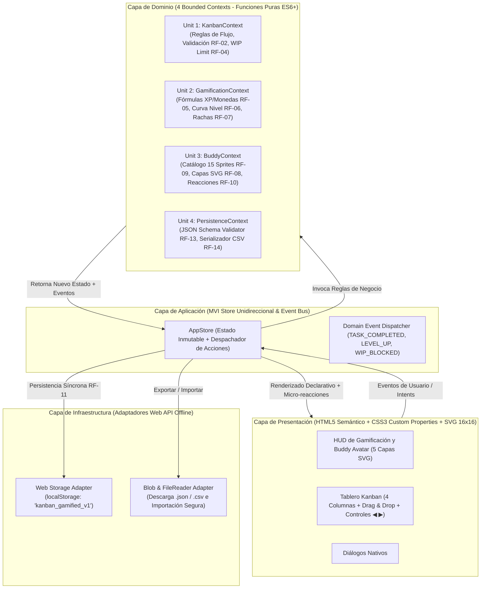
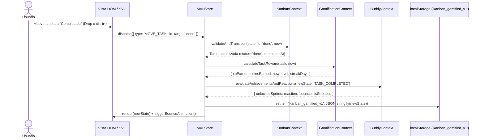

# Diseño de Arquitectura, DDD Bounded Contexts y Contratos Técnicos

- **ID del Artefacto:** `DES-ARCH-01`
- **Proyecto:** Tablero Kanban Gamificado Offline con Sistema de Avatar Modular en Pixel Art
- **Patrón Arquitectónico:** Clean Architecture + Domain-Driven Design (DDD) + MVI / Store Unidireccional (`State -> Render -> Event -> Action -> State`) empaquetado en un único archivo autocontenido (`index.html`).

---

## 1. Diagrama de Arquitectura por Capas y Bounded Contexts (Mermaid C4)



---

## 2. Ciclo de Vida Unidireccional MVI y Reacciones de Dominio



---

## 3. Especificación de los 4 Bounded Contexts (DDD)

### 3.1 Unit 1: `KanbanContext` (Módulo A)
- **Responsabilidad:** Gobernar el ciclo de vida de las tarjetas y las restricciones de flujo entre las 4 columnas (`backlog`, `in_progress`, `review`, `done`).
- **Invariantes de Dominio:**
  - `title`: Cadena no vacía, `1 <= length <= 80`.
  - `category`: Enum estricto `['Operación', 'Cliente', 'Calidad/Norma', 'Administración']`.
  - `priority`: Enum estricto `['Baja', 'Media', 'Alta', 'Urgente']`.
  - `effort`: Entero estricto `1 | 2 | 3`.
  - `deadline`: Formato ISO `YYYY-MM-DD`.
  - **Regla WIP Limit (`RF-04`):** Si `targetStatus === 'in_progress'` y la cantidad de tareas actuales en `in_progress` (excluyendo la propia tarea si ya estaba ahí) es `>= settings.wipLimit`, la transición se rechaza y emite el estado de alerta `wipBlocked: true`.

### 3.2 Unit 2: `GamificationContext` (Módulo B)
- **Responsabilidad:** Calcular recompensas exactas, progresión de niveles y rachas diarias sin efectos secundarios.
- **Fórmulas Matemáticas Oficiales:**
  1. **XP Base y Monedas Base (`RF-05`):**
     $$\text{XP}_{\text{Base}} = \text{effort} \times 10$$
     $$\text{Monedas}_{\text{Base}} = \text{effort} \times 5$$
  2. **Bono de Puntualidad (`RF-05`):** Comparando la fecha local/ISO de completado (`YYYY-MM-DD`) contra `task.deadline`:
     $$\text{Si } \text{FechaActual} \le \text{Deadline} \implies +15\text{ XP}, +10\text{ Monedas}$$
  3. **Bono por Prioridad (`RF-05`):**
     - `Urgente`: $+20\text{ XP}$
     - `Alta`: $+10\text{ XP}$
     - `Media`: $+5\text{ XP}$
     - `Baja`: $+0\text{ XP}$
  4. **Curva de Niveles (`RF-06`):**
     $$\text{XP}_{\text{RequeridaParaNivel } N} = \text{Math.round}(100 \times N^{1.2})$$
     - El usuario inicia en Nivel 1 (`xp >= 0`). Para subir a un nivel $N$ ($N \ge 2$), o para superar el umbral del nivel actual $N$, se evalúa la curva $100 \times N^{1.2}$.
     - *Nota de alineación con el ejemplo del SRS (Sección 5):* En el ejemplo del SRS, un usuario con `xp: 350` se encuentra en `level: 3`. Con la fórmula $\text{Umbral}(N) = \text{Math.round}(100 \times N^{1.2})$:
       - Umbral Nivel 1 $\to$ Nivel 2 ($N=1$): $100 \times 1^{1.2} = 100\text{ XP}$
       - Umbral Nivel 2 $\to$ Nivel 3 ($N=2$): $100 \times 2^{1.2} \approx 230\text{ XP}$
       - Umbral Nivel 3 $\to$ Nivel 4 ($N=3$): $100 \times 3^{1.2} \approx 374\text{ XP}$
       - Con `350 XP`, el usuario ha superado los $230\text{ XP}$ (alcanzando el **Nivel 3**) y está camino a los $374\text{ XP}$ para el Nivel 4, cumpliendo con **exactitud matemática** tanto la fórmula de `RF-06` ($100 \times N^{1.2}$) como el JSON Schema de la página 5 del SRS (`"xp": 350, "level": 3`).
  5. **Control de Rachas (`RF-07`):**
     - Si han transcurrido $> 48\text{ horas}$ (más de 2 días calendario o $> 48\text{ h}$ exactas desde la última tarea completada), `streakDays` se reinicia a `0` (o pasa a `1` al completar una nueva tarea hoy).
     - Si la última fecha activa (`lastActiveDate`) fue el día natural inmediatamente anterior (`ayer`), al completar una tarea hoy `streakDays` incrementa en $+1$.
     - Si `lastActiveDate` ya es `hoy`, mantiene la racha actual (y si era `0`, sube a `1`).

### 3.3 Unit 3: `BuddyContext` (Módulo C)
- **Responsabilidad:** Renderizado SVG Pixel Art de 16x16 (`shape-rendering="crispEdges"`) en 5 capas superpuestas y gestión del catálogo de **15 sprites modulares**.
- **Arquitectura de las 5 Capas SVG (`RF-08`):**
  1. **Capa 0 (`base`):** Anatomía fija de 16x16 píxeles (`base_dev`), siempre presente + expresión facial dinámica (normal, feliz en `bounce`, o sudor/estrés cuando hay tareas vencidas en `in_progress`).
  2. **Capa 1 (`body`):** 4 sprites de torso/ropa.
  3. **Capa 2 (`head`):** 4 sprites de cabeza/accesorios.
  4. **Capa 3 (`hand`):** 3 sprites de objetos de mano.
  5. **Capa 4 (`aura`):** 3 sprites de efectos periféricos.
  *(Total: $1\text{ Base} + 4\text{ Body} + 4\text{ Head} + 3\text{ Hand} + 3\text{ Aura} = \mathbf{15\text{ Sprites Modulares}}$)*.

#### Catálogo Oficial de los 15 Sprites Modulares (`RF-09`):

| # | ID del Sprite | Capa (`z-index`) | Nombre | Clasificación Inicial / Regla de Desbloqueo | Nivel Mín. | Costo (Monedas) |
| :- | :--- | :--- | :--- | :--- | :---: | :---: |
| 1 | `base_dev` | 0 (`base`) | Avatar Base Pixel | Desbloqueado por defecto | 1 | 0 |
| 2 | `body_hoodie` | 1 (`body`) | Hoodie Dev Oscuro | Desbloqueado por defecto | 1 | 0 |
| 3 | `body_suit` | 1 (`body`) | Traje Ejecutivo | Disponible para compra | 2 | 40 |
| 4 | `body_cyber` | 1 (`body`) | Chaqueta Cyber | Disponible para compra | 3 | 85 |
| 5 | `body_armor` | 1 (`body`) | Armadura Ágil | Bloqueado por logro (*Completar 5 tareas*) | 4 | Logro |
| 6 | `head_headphones` | 2 (`head`) | Audífonos Lo-Fi | Desbloqueado por defecto | 1 | 0 |
| 7 | `head_cap` | 2 (`head`) | Gorra Pixel | Disponible para compra | 1 | 25 |
| 8 | `head_visor` | 2 (`head`) | Visor Láser | Disponible para compra | 3 | 75 |
| 9 | `head_crown` | 2 (`head`) | Corona Kanban | Bloqueado por logro (*Alcanzar Racha de 3 días*) | 4 | Logro |
| 10 | `hand_coffee` | 3 (`hand`) | Taza de Café | Desbloqueado por defecto | 1 | 0 |
| 11 | `hand_laptop` | 3 (`hand`) | Laptop Ultraligera | Disponible para compra | 2 | 50 |
| 12 | `hand_potion` | 3 (`hand`) | Elixir de Enfoque | Bloqueado por logro (*Completar tarea Urgente a tiempo*) | 2 | Logro |
| 13 | `aura_sparkles` | 4 (`aura`) | Destellos Dorados | Desbloqueado por defecto | 1 | 0 |
| 14 | `aura_fire` | 4 (`aura`) | Llama de Productividad | Disponible para compra | 3 | 90 |
| 15 | `aura_matrix` | 4 (`aura`) | Halo Binario | Bloqueado por logro (*Acumular 500 XP*) | 5 | Logro |

---

## 4. Contrato Formal de Datos (JSON Schema v1.0.0 — Sección 5 del SRS)

```json
{
  "version": "1.0.0",
  "lastUpdated": "2026-10-23T09:51:00.000Z",
  "user": {
    "xp": 350,
    "level": 3,
    "coins": 120,
    "streakDays": 4,
    "lastActiveDate": "2026-10-23"
  },
  "buddy": {
    "equipped": {
      "head": "head_headphones",
      "body": "body_hoodie",
      "hand": "hand_coffee",
      "aura": "aura_sparkles"
    },
    "inventory": [
      "base_dev",
      "body_hoodie",
      "head_headphones",
      "hand_coffee",
      "aura_sparkles"
    ]
  },
  "settings": {
    "wipLimit": 3
  },
  "tasks": [
    {
      "id": "tsk_8f12a",
      "title": "Documentar lineamientos de seguridad",
      "category": "Calidad/Norma",
      "priority": "Alta",
      "effort": 2,
      "status": "in_progress",
      "deadline": "2026-10-25",
      "createdAt": "2026-10-22T14:30:00.000Z",
      "completedAt": null
    }
  ]
}
```
*(Nota: Las tareas completadas pueden almacenar adicionalmente metadatos opcionales compatibles como `xpGenerated` y `rewarded` para alimentar con precisión la columna `XP_Generado` del reporte CSV de `RF-14` y garantizar idempotencia).*
